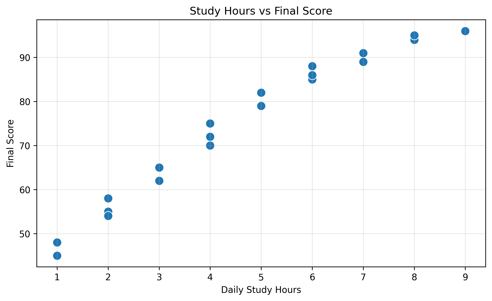
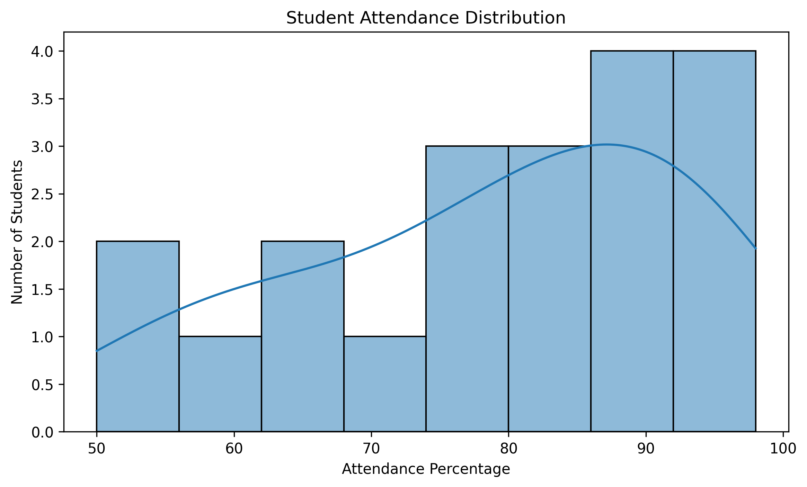
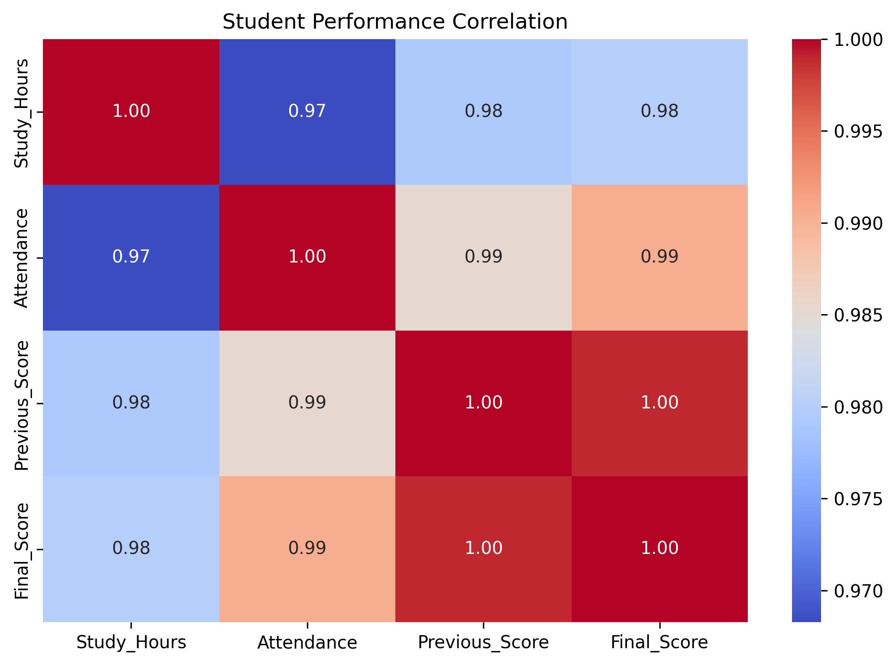

# Student Performance Analysis

## Project Overview

This project explores student academic performance using Python and Exploratory Data Analysis (EDA).

The objective is to understand how study hours, attendance and previous academic scores relate to students' final examination performance.

## Dataset Description

The dataset contains the following columns:

| Column | Description |
|---|---|
| Student_ID | Unique student identifier |
| Study_Hours | Daily study hours |
| Attendance | Attendance percentage |
| Previous_Score | Previous examination score |
| Final_Score | Final examination score |

## Technologies Used

- Python
- Pandas
- NumPy
- Matplotlib
- Seaborn
- Jupyter Notebook

## Project Workflow

1. Data Collection
2. Data Loading
3. Data Inspection
4. Data Cleaning
5. Exploratory Data Analysis
6. Statistical Analysis
7. Data Visualization
8. Insights and Conclusions

## Repository Structure

- `dataset/` - Student performance dataset
- `notebooks/` - Jupyter Notebook analysis
- `visualizations/` - Data visualization outputs
- `requirements.txt` - Python dependencies

## How to Run

1. Clone this repository.
2. Install dependencies using `pip install -r requirements.txt`.
3. Open the notebook in Jupyter Notebook or Google Colab.
4. Run the notebook cells sequentially.

## Author

**Tejas Prakash Chavan**

Aspiring Data Analyst | Python | SQL | Excel | Power BI

[LinkedIn](https://linkedin.com/in/tejas-chavan-b4b576395)

## Data Visualizations

### 1. Study Hours vs Final Score

This scatter plot explores the relationship between students' daily study hours and their final examination scores.

### 2. Attendance Distribution

This histogram displays the distribution of student attendance percentages.

### 3. Correlation Heatmap

This heatmap visualizes the correlations between numerical variables in the dataset.

## Key Findings and Insights

### Statistical Findings

- Average study time: 4.65 hours per day.
- Average attendance: 78.8%.
- Average previous examination score: 70.50.
- Average final examination score: 74.45.

### Correlation Analysis

The correlation analysis identified strong positive relationships with final examination scores:

- Study Hours: 0.980
- Attendance: 0.990
- Previous Score: 0.999

### Analytical Observations

1. Study hours show a strong positive relationship with final examination scores.
2. Attendance also shows a strong positive relationship with final scores.
3. Previous examination scores have the strongest correlation with final scores in this sample.

### Conclusion

The exploratory analysis highlights relationships between study habits, attendance, previous academic performance and final examination scores.

**Dataset limitation:** This project uses 20 sample records created for educational purposes. The findings are illustrative and should not be generalized to real student populations.

### Future Improvements

- Analyze a larger real-world dataset.
- Explore additional student performance factors.
- Build predictive models using Machine Learning.
- Develop an interactive Power BI dashboard.

## Dataset Note

This project currently uses a 20-record sample dataset created for educational and demonstration purposes. The findings should not be interpreted as conclusions about a real student population.
